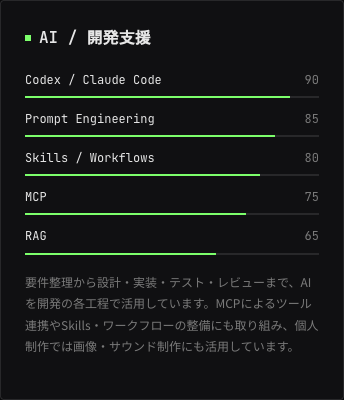
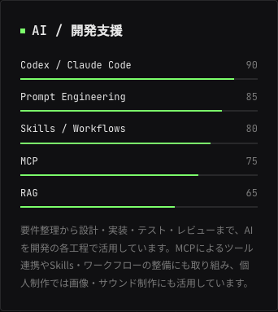
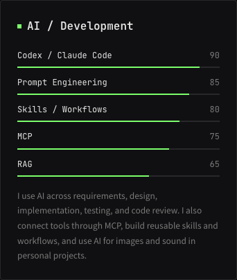

# SkillsのAI・開発支援

- 機能ID: `portfolio-skills`
- 目的: AIの製品名・API名の列挙から、開発工程での活用方法とツール連携が伝わる紹介にする。
- 最終確認日: 2026-11-05 JST。
- 確認したコード: `codex/portfolio-ai-skills` / 基準main `cec27551c6aaecefc8efdd9571b6650798384629` ＋今回の未コミット差分。
- 関連チケット・PR: なし。
- Plane: `plane_personal` / `hiro-work` の全21プロジェクトに当リポジトリの対応先がなく、未同期。[投稿予定本文](plane-draft.html)をローカルに保存。

## 開発中の変更

トップページのSkills（`/#skills`）の `ai` カテゴリを更新する。

| 対象 | 内容 |
|---|---|
| 日本語の見出し | AI / 開発支援 |
| 英語の見出し | AI / Development |
| 掲載項目 | Codex / Claude Code、Prompt Engineering、Skills / Workflows、MCP、RAG |
| 製品名の扱い | コーディング支援ツールはCodex / Claude Codeの1行にまとめ、説明文では特定の製品名を使わない。Claude APIは削除 |
| 説明 | 要件整理・設計・実装・テスト・レビュー、MCPでのツール連携、Skills・ワークフローの整備、個人制作の画像・サウンド制作での活用を紹介 |
| 評価表示 | 従来の5行と値90 / 85 / 80 / 75 / 65を維持。評価の尺度や表示コンポーネントは変更しない |

AI以外のカテゴリ、Works、プロフィール等の文言は変更しない。新しいAPI連携機能や外部送信を追加するものではない。

## 実装・検証・配信

| 対象 | 実装 | 検証 | 配信 |
|---|---|---|---|
| Web | skillData.tsと日英JSONへローカル実装 | Lint・TypeScript・Next.js 16.4.3の静的ビルド成功。実ブラウザ確認済み | 未公開。ローカルプレビューのみ |
| iOS / Androidネイティブ | 対象外 | 対象外 | 対象外 |
| Plane | 仕様・画像・投稿予定本文をローカルに保存 | 保存先の対応関係を確認できず | 本文・画像とも未同期 |

検証コマンド: `npm run lint`、`./node_modules/.bin/tsc --noEmit`、`npm run build`、`git diff --check`。既存依存関係を使用し、package.jsonとlockfileは変更していない。

macOS上のPlaywright Chromium実ブラウザで、日本語1440×1000・390×1000と英語390×1000を確認。5項目・数値、Claude APIの非表示、日英切り替え、カード内・ページ全体の横はみ出しなしを確認。console error / warning 0。スキルバーが規定の長さになるのを待って撮影し、全画像を開いて目視確認した。モバイル幅はエミュレーションで、iOS Safari / Android Chromeの実機確認ではない。

## 実画面

共通条件: **local / 本人のMac / macOS / Playwright Chromium / 2026-11-05 JST / main・cec27551＋今回の未コミット差分**。静的出力を `http://127.0.0.1:3048/` で配信し、AIカード部分を撮影。

日本語、PC幅1440×1000:

日本語、モバイル幅390×1000:

英語、モバイル幅390×1000:

## 残作業

- 本番公開は未実施。変更内容を確認できるローカルプレビューを用意した。
- Planeは対応する保存先の指定後、本文と画像を同期する。別のプロジェクトへの投稿や新規プロジェクトの作成は行わない。

## 更新箇所

- [項目と自己評価値](../../../src/data/skillData.ts)
- [日本語](../../../src/content/ja.json) / [英語](../../../src/content/en.json)
- 表示は既存の `src/components/chakra/Skills.tsx` を使用。

## 2026-11-05の公開承認・準備

ユーザーがAI項目のプレビューを確認し、本番反映を承認。個人GitHub認証takahiro-saekiとリポジトリownerを確認し、最新mainが基準cec27551から変わっていないことをfetch後に照合した。前回のLint・型チェック・静的ビルド・画面確認からアプリコードの追加変更はないため、その検証結果を使用し、公開用PRのCIで再確認する。公開対象はAI関連の3ソースファイルと本機能の仕様・画像のみ。前回のWorks配信記録等の未コミット差分は保持し、今回のPRへ含めない。公開後のPR・main・配信SHAと本番画面の確認結果は、この記録へ追記する。
