# 制作物一覧と登壇資料

- 機能ID: `portfolio-works`
- 目的: アプリ・ゲーム・登壇資料と、掲載許可を得たビジネス案件を紹介し、公開先へ移動できるようにする。
- 最終確認日: 2026-11-05（JST）
- 確認したコード: `codex/portfolio-apps-and-client-work` / 最新main `24c48f797e318142dbfbbab8384ec64c6346084b` を基準とした公開準備差分。
- 関連チケット: なし。公開用PRは作成後に配信記録へ追記する。
- Plane: `plane_personal` のプロジェクト全21件を照合したが、当リポジトリに対応するプロジェクトは確認できず、未同期。投稿予定本文は [plane-draft.html](plane-draft.html)。

## ローカル版でできること

- トップページの Works（`/#contents`）に14件を掲載する。内訳は Web / Apps 6件、Games 7件、登壇資料1件。ビジネス案件は0件で、Coming Soonを表示する。
- 「すべて」「Web / Apps」「Games」「登壇資料」「ビジネス案件」で絞り込み、表示件数を確認できる。
- 先頭に Bezi Mega Jam 向けの Haine、その次に VOLT NOMAD の登壇資料を置く。続いて今回追加したゲームを表示し、従来の制作物も保持する。
- Haine は「開発版公開中」と表示する。Jamへの正式提出・完成を意味しない。
- 登壇資料カードから Speaker Deck とゲームを開ける。VOLT NOMAD のゲームカードからも登壇資料へ移動できる。
- 日本語・英語に対応する。切り替えても選択中のカテゴリを維持する。資料の正式タイトルは英語表示でも日本語のまま、説明に日本語の資料であることを記載する。
- モバイルは1列、デスクトップは2列。フィルターボタンは折り返す。ボタン・作品リンクは高さ44px以上で、キーボードフォーカスを表示する。
- フィルターに `aria-pressed`、件数に `aria-live`、作品に `article` と見出しを使用する。外部リンクは別タブで開き、`noopener noreferrer` を設定する。
- カバーはローカルの WebP を遅延読み込みする。16:9の領域を確保し、画像全体を表示する。
- Voices DiaryとSquadNoteのカードには、それぞれの公開トップ画面を撮影したスクリーンショットを日英共通で表示する。
- 共通 `useReveal` は動きの低減時に `opacity: 1` / `y: 0` を明示する。SSRで設定された透明な初期状態が残る問題を修正した。

## 追加した掲載内容と根拠

2026-09-19に以下の公開ページを確認した。制作物の公開状態とポートフォリオの配信状態は別に管理する。

| 制作物 | 掲載内容 | 確認元 |
|---|---|---|
| Haine · The Soul Ledger | 灰猫の魔女、5×5ビンゴ×ターン制カードバトル、Bezi Mega Jam 2026向けの開発版 | [itch.io](https://tsgamestudio.itch.io/haine-the-soul-ledger) |
| AIとGame Jamで、ゲームを完成させた話 | VOLT NOMADの制作過程、Codex・PixelLab・Sunoの活用。2026-08-27公開 | [Speaker Deck](https://speakerdeck.com/takahirosaeki/ai-to-game-jam-de-gemu-o-kansei-saseta-hanashi) |
| First Light | 48時間で制作した横スクロールシューティング・ローグライク、Nimble Game Jam 2026 | [itch.io](https://tsgamestudio.itch.io/first-light) |
| NO HEROES LEFT | 3機体・全5ステージの縦スクロール弾幕ローグライト、Week Sauce、5言語対応 | [itch.io](https://tsgamestudio.itch.io/no-heroes-left) |
| PRIMAL COUNTDOWN | 恐竜の群れを90秒しのぎT-Rexから逃げる短編アクション、Micro Jam 063 | [itch.io](https://tsgamestudio.itch.io/primal-countdown) |

既存の未コミット差分にあった VOLT NOMAD の紹介を掲載対象として取り込み、カバーと資料へのリンクを追加した。プロフィール・フッター更新とモーション実験ページは今回の公開差分には含めていない。

## カバー画像の出典

保存先は `public/images/works/`。ユーザーの既存作品素材をWebPへ変換し、追加の生成素材は使用していない。

- Haine、NO HEROES LEFT、PRIMAL COUNTDOWN、VOLT NOMAD、Roll for Six、LOOP HAXE: 各作品のitch.io公開ページの `og:image`。
- First Light: 同じ個人リポジトリ `nimble-game-jam-2026/build/itch/cover_960x540.png` の提出用カバー。
- 登壇資料: [Speaker Deckの表紙](https://files.speakerdeck.com/presentations/7ab7a0b2e373497897b8c66283a0e3e7/slide_0.jpg)。
- Voices Diary / SquadNote: 2026-09-19、macOS / Chromium / 1440×810で未ログインの公開トップ画面を撮影。撮影元は [Voices Diary](https://voicesdiary.com/) と [SquadNote](https://squad-note.com/)。公開サイトのコード版は未確認。認証後の個人データは含まない。SquadNoteのアクセス解析同意バナーは「同意しない」で閉じている。
- 撮影元PNGは [Voices Diary](assets/voicesdiary-home-source.png) / [SquadNote](assets/squadnote-home-source.png)。掲載用は1200×675のWebP（それぞれ約32 KiB / 52 KiB）に変換。
- 画像ファイル10点、合計約415 KiB。ゲームは幅800px以内、資料は幅1000px以内、公開トップ画面は幅1200px。全12カードに画像がある。

## 実装・検証・配信

| 対象 | 実装 | 検証 | 配信・利用条件 |
|---|---|---|---|
| Web local | `codex/portfolio-works-refresh` に実装 | Lint・TypeScript・静的ビルド成功。実ブラウザ確認済み | `out/` をローカルHTTPサーバーで確認 |
| Web production | 今回の変更は未反映 | 未確認 | push・デプロイは実施していない |
| iOS / Android アプリ | 対象外 | 対象外 | ネイティブ実装はない。モバイル幅はWebとして確認 |

検証内容:

- `npm run lint`、`npx tsc --noEmit`、`npm run build`。最終ビルド内のTypeScript検証も成功。
- Chromium / macOS、1440×1100と390×1000。日英の表示、横はみ出しなし。
- カテゴリ件数: 全件12、Web / Apps 4、Games 7、登壇資料1。
- 言語切り替え後もフィルターを維持し、`html lang`・URLの `lang` パラメーター・文言が更新される。
- キーボードのEnterでカテゴリを選択し、TabでSpeaker Deckのリンクへ移動できる。
- 動きを減らす設定で再読み込み後の全12カードの `opacity` が1であることを確認。通常設定の出現アニメーションも確認。
- 公開資料へのhref、外部リンク属性、全カバー画像の読み込みを確認。
- 公開トップ画面の追加後に静的ビルドとTypeScript検証を再実行し成功。PC・モバイル幅で両画像が読み込まれることと、英語に切り替えても同じ画像を表示することを確認。

## 画面

以下は全て **local / macOS / Playwright Chromium（実ブラウザ、モバイル幅はエミュレーション）/ 2026-09-19 / `main`・`ae9de2e` + 未コミット差分** の実画面。ポートフォリオ本番の配信証明ではない。

### Web / Apps / PC / 日本語

公開トップ画面を追加したVoices DiaryとSquadNote。1440×1100、動きを減らす設定で撮影。

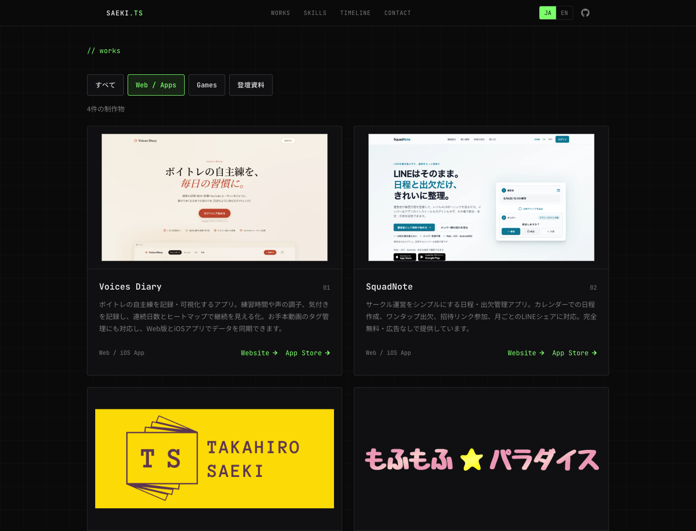

### Web / Apps / モバイル幅 / 日本語

390×1000、動きを減らす設定で撮影。

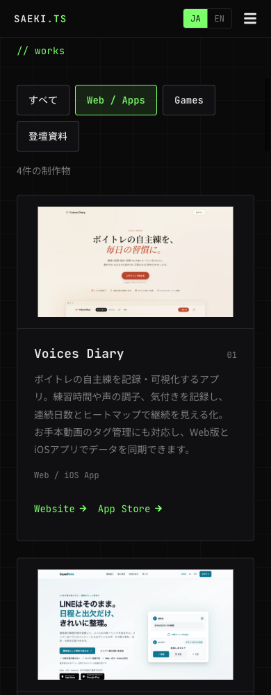

### Works / PC / 日本語

Haineと登壇資料を先頭に掲載。通常のアニメーション設定で撮影。

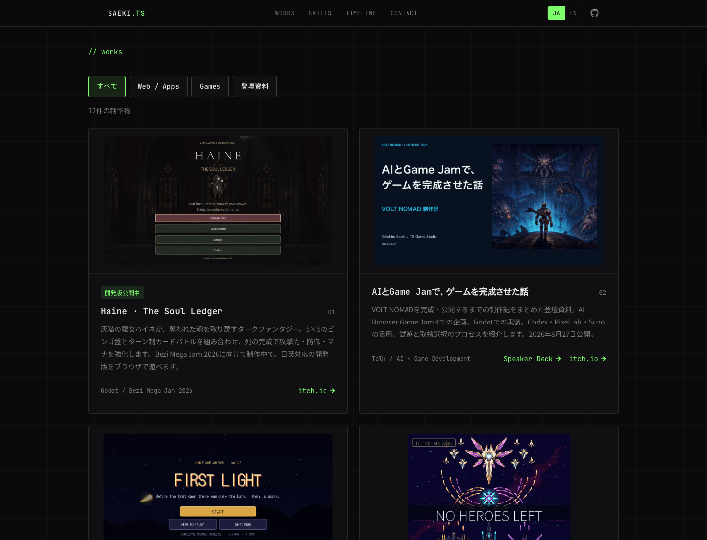

### Works / モバイル幅 / 日本語

折り返すカテゴリボタンとHaineの開発版表示。動きを減らす設定で撮影。

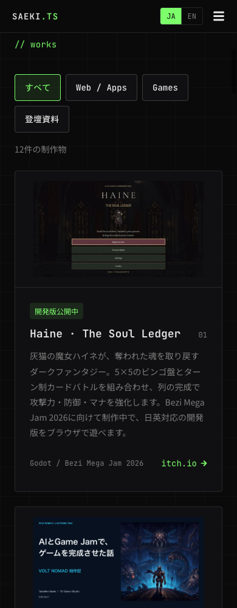

### Works / モバイル幅 / 英語

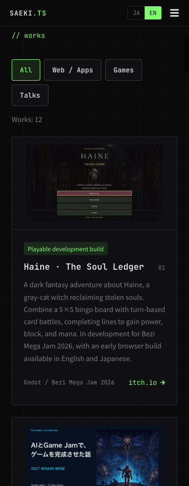

### 登壇資料の絞り込み / モバイル幅 / 日本語

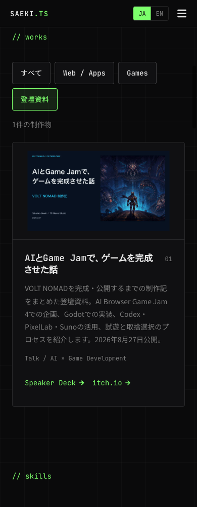

## 公開準備

2026-09-19、ユーザーが本番反映を承認。最新のmain（80c8166）の依存関係で検証後、GitHub Pagesへ反映する。下記の本番未反映状態は配信前時点の記録で、実際の配信結果は完了後に追記する。

## 残作業・制限

- 本番への反映は未実施。
- Planeの対応プロジェクトが未確認のため、機能一覧・本文・画像は未同期。新規プロジェクトや別Wikiは作成していない。
- iOS Safari / Android Chrome の実機確認は未実施。
- 制作物の情報は日英JSONで管理し、itch.io等からの自動同期は行わない。
- カテゴリ選択はリロードで初期化する。URLに保存するのは既存仕様の言語だけ。
- Haineは開発版として掲載し、Jam提出・完成の更新は根拠を再確認して行う。

## 更新箇所

- [日本語コンテンツ](../../../src/content/ja.json) / [英語コンテンツ](../../../src/content/en.json)
- [コンテンツの型](../../../src/content/types.ts)
- [Worksの表示](../../../src/components/chakra/Contents.tsx)
- [共通の表示アニメーション](../../../src/components/chakra/useReveal.ts)

## 2026-10-04の掲載情報更新（ローカル・未公開）

基準は `main` / `323ee73ff3f001b6e81200b7529950c435901c8f` と、作業開始時点の既存未コミット差分。プロフィール・フッターの追加リンク・モーション実験ページ等の既存差分は保持した。今回の掲載情報修正はローカルの作業差分にのみ反映し、push・PR作成・マージ・本番デプロイは実施していない。

| 対象 | 日英の変更 | 公開情報の根拠 |
|---|---|---|
| SquadNote | `Web / iOS / Android App` 表記、Google Playリンクを追加。公開日程はアプリ・ログイン不要で回答できること、定員・キャンセル待ち・空き枠への繰り上げ、月次LINE共有を紹介 | [公式サイト](https://squad-note.com/)、[機能紹介](https://squad-note.com/features)、[Google Play](https://play.google.com/store/apps/details?id=com.squadnote.app)、[App Store](https://apps.apple.com/jp/app/squadnote/id6766142849) |
| Haine | ラインに装備した刻印の発動、26種のカード、分岐ルートを紹介。日英とも公開ブラウザ開発版のステータスとitch.ioリンクを維持 | [itch.ioの公開開発版](https://tsgamestudio.itch.io/haine-the-soul-ledger) |
| もふパラ | フッターのURLをHTTPからHTTPSへ変更 | [HTTPSの公開ページ](https://takahiro-saeki.github.io/new-book/template/) がMacからHTTP 200 |

SquadNoteのGoogle Playリンクは、ユーザーのMac上のPlaywrightブラウザで公式サイトからクリックし、商品名「SquadNote - 練習日程と出欠」、開発者「三枝木貴浩」、「インストール」ボタンを確認した。端末へのインストールは行っていない。紹介文の「完全無料・広告なし」は今回参照した公式紹介で再確認できなかったため、確認できた機能の説明に置き換えた。料金や広告方針の変更を確認したものではない。

Haineの非公開TestFlightやネイティブアプリの公開を示す情報は追加していない。スキル評価、稼働状況、職歴、非公開の顧客情報は変更していない。

### 実装・検証・配信状態

- 実装: 日英JSONの修正とこの記録を既存チェックアウトの未コミット差分へ追加。
- 検証: 作業用コピーに既存差分を含め、CIと同じ `npm run lint`、`npx tsc --noEmit` 相当のローカルTypeScript実行、`npm run build` が成功。最初のビルドはGoogle Fontsへの通信制限で失敗したが、通信可能な実行で再検証し成功。専用のtestスクリプトはない。
- 内容確認: 両JSONの構文、12作品の維持、画像ファイルの存在、日英のSquadNoteリンク一致、Haineの開発版表記を確認。既存差分を基準に今回指定した項目だけが変わったことを照合した。
- 表示確認: 静的ビルドの `out/` をMacの `127.0.0.1:3044` で配信。日本語1440×1100、英語390×1000（モバイル幅のエミュレーション）を実ブラウザで確認。Web / Appsの4件表示、言語切り替え後のフィルター維持、Android表記、3リンク、画像読み込み、横はみ出しなし、リンク高さ44px、外部リンクの `target="_blank"` と `rel="noopener noreferrer"` を確認。ブラウザのerror / warningは0。
- 配信: 今回の差分は本番未反映。Planeへの同期も行っていない。

### ローカル確認画面

**local / ユーザーのMac / macOS / Playwright Chrome（実ブラウザ）/ 2026-10-04 UTC / main・323ee73 + 既存未コミット差分 + 今回の掲載情報更新**。静的ビルドを使用し、動きを減らす設定でSquadNoteのカードを撮影した。

日本語・PC幅（1440×1100）:

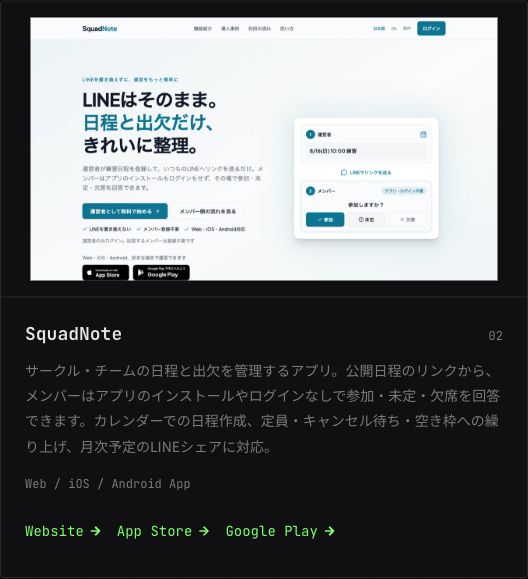

英語・モバイル幅（390×1000、実機ではなくエミュレーション）:

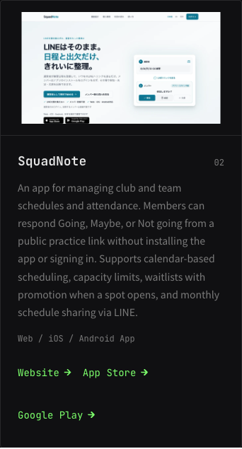

### 確認を残した事項

- 「完全無料・広告なし」を紹介文へ再掲載する場合は、現行方針の確認が必要。
- Android実機へのインストール、iOS Safari / Android Chromeの実機確認は未実施。
- 本番反映はユーザーによる今回分の差分確認後に別途行う。既存の未コミット差分をまとめて公開する前提にはしない。

## 2026-10-05の本番公開準備

ユーザーがローカルプレビューを確認し、本番リリースを承認。最新版 `main` / `8985770276d3ecbd18b1a3d53038c303a20531bd` を基準に、上記の日英コンテンツ修正とローカル検証記録・画像2点だけを独立した公開ブランチへ移した。元チェックアウトにあるプロフィール・フッターの追加リンク・モーション実験・過去の配信記録等の未コミット差分は公開対象に含めていない。

- 実装: 公開ブランチに準備済み。
- 検証: 最新mainのlockfileでlint・型チェック・静的ビルドを実行し、必須PR CIを確認してから統合する。
- 配信: このコミット作成時点では未配信。GitHub Pagesの実際の配信結果と本番検証は、配信後にローカル記録へ追記する。記録だけを目的とした追加配信は行わない。

## 2026-11-05: アプリ2件とビジネス案件カテゴリ（ローカル・未公開）

### 追加した表示・動作

- Web / Appsの先頭に「きょうのへぇ」（英語ではDaily Aha）と「PackHabit」を掲載。各カードに紹介文、公開用紹介画像、公式サイト・App Store・Google Playへの3リンクを置く。
- 既存12件を保持し、制作物は全14件。Web / Apps 6件、Games 7件、登壇資料1件。
- 日英のフィルターへ「ビジネス案件」/「Client Work」を追加。掲載実績がない間は、Coming Soonと「Webサイトの制作・改善など、個人でお受けしたお仕事を、掲載許可をいただいたものから順次ご紹介します。」を表示する。
- Coming Soonは「すべて」と「ビジネス案件」で表示し、制作物件数には含めない。ビジネス案件の件数は現在0。仮の顧客名・案件実績・成果数値・外部リンクは設けない。
- 将来、許可を得た実績を日英の `works.items` に `category: "business"` として追加すると、通常の作品カードと件数に反映され、Coming Soonは自動で非表示になる。
- 既存のフィルター選択保持、言語切り替え、外部リンク属性、モバイル1列・PC2列は維持する。Coming SoonはPCでもグリッドの全幅を使う。

### 掲載情報・画像の根拠

2026-11-05に以下の公式ページ6件へ接続し、HTTP 200とページタイトルの一致を確認した。アプリ本体の変更・ストア提出・ネイティブ実機検証は今回の対象外。

| アプリ | 公式サイト | App Store | Google Play |
|---|---|---|---|
| きょうのへぇ / Daily Aha | [公式サイト](https://takahiro-saeki.github.io/daily-aha-support/) | [iOS](https://apps.apple.com/jp/app/id6825774534) | [Android](https://play.google.com/store/apps/details?id=com.takahiro_saeki.dailyaha) |
| PackHabit | [公式サイト](https://takahiro-saeki.github.io/packhabit-support/) | [iOS](https://apps.apple.com/jp/app/packhabit/id6824839561) | [Android](https://play.google.com/store/apps/details?id=jp.takahiro.packhabit) |

- 説明は公開版の機能に合わせ、開発中のDaily AhaのAIニュース・お気に入り等は掲載しない。
- 紹介画像は本人の各アプリのストア掲載用feature graphicをWebPへ変換したもの。AIによる作り直しやモックの新規生成は行っていない。1024×500、Daily Aha 14,436バイト、PackHabit 15,818バイト。日英で同じ画像を使用する。
- Daily Aha画像の取得元: `daily-aha/docs/releases/1.0.0/store-assets/android/feature-graphic/1024x500/ja/01-feature-graphic.png`。
- PackHabit画像の取得元: `packhabit/docs/store/assets/feature-graphic.png`。
- 公開用ファイル: `public/images/works/daily-aha.webp`、`public/images/works/packhabit.webp`。

### 実装・検証・配信・Wikiの状態

| 区分 | 確認した状態 |
|---|---|
| 実装 | 現チェックアウトの `main` / `323ee73ff3f001b6e81200b7529950c435901c8f` ＋既存未コミット差分へ今回分を追加。既存のプロフィール、フッター、モーション実験等の変更を保持。コミット・push・PR作成なし |
| 比較基準 | 個人GitHub認証 `takahiro-saeki` とownerを照合。APIで最新main `24c48f797e318142dbfbbab8384ec64c6346084b` を確認し、既存12件のWorksデータとContents.tsxが今回の作業前ファイルと一致することを確認。checkout・pull・resetは行っていない |
| 静的検証 | `npm run lint`、`./node_modules/.bin/tsc --noEmit`、`npm run build`、`git diff --check` が成功。今回のビルドは既存インストール済み依存関係（Next.js 16.3.0）を使用。依存・lockfileの変更なし |
| Web表示 | 静的ビルドを `http://127.0.0.1:3044/` で配信。macOS上のPlaywright Chromium実ブラウザで日英、PC幅1440、モバイル幅390を確認。モバイル幅はエミュレーションで実機ではない |
| 操作検証 | 全14件・Apps 6件・Games 7件・登壇資料1件・ビジネス案件0件、Coming Soon表示条件、言語切り替え後の選択保持、Enterキーでのフィルター操作を確認。全確認状態で横はみ出しなし。フィルターとリンクは高さ44px、外部リンクは別タブ・noopener noreferrer。追加画像の読み込み成功。通常モーションと動きを減らす設定で表示を確認。ローカルページのconsole error / warningは0 |
| Web配信 | 本変更は本番未反映。ローカルプレビューのみ。既存本番は今回変更していない |
| ネイティブ配信 | 対象外。リンク先のiOS・Androidアプリの配信操作は行っていない |
| Plane | `plane_personal` の `hiro-work` を再照合。全21プロジェクトに当リポジトリの対応先がないため未同期。別プロジェクトへの投稿や新規プロジェクト作成なし。更新予定本文は `plane-draft.html` に追記し、画像は下記に保存 |

### ローカルの実画面

共通条件: **local / 本人のMac / macOS / Playwright Chromium / 2026-11-05 JST / main・323ee73 + 着手時の既存差分 + 今回の未コミット変更**。静的ビルドを撮影。画像の可読性と選択中のフィルター表示を目視確認済み。撮影時は動きを減らす設定とアニメーション終了状態を使用した。

**Web / Apps、日本語、PC幅1440×820**。2件のカード・3リンクと6件表示。

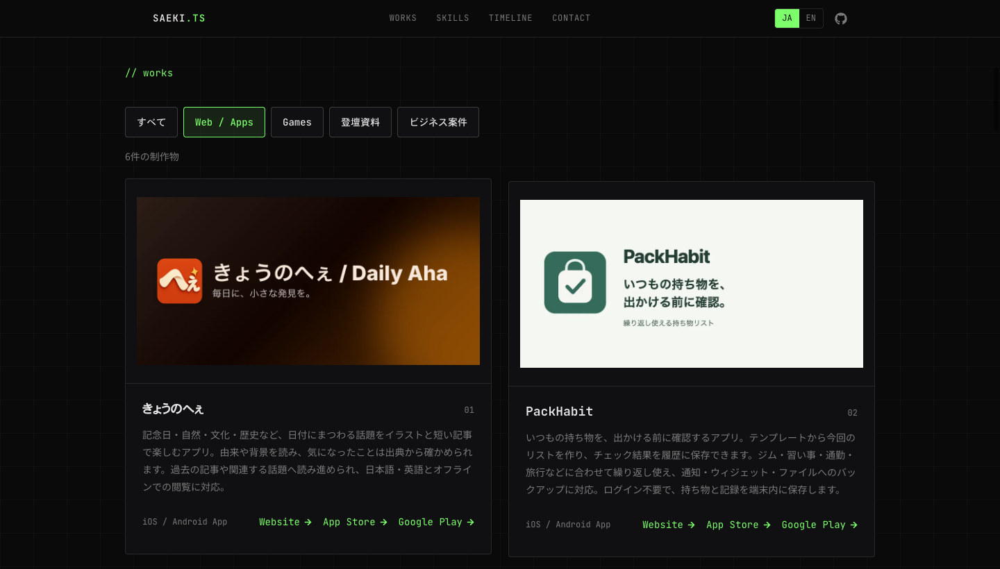

**ビジネス案件、日本語、PC幅1440、Works部分のキャプチャ**。実績0件、Coming Soonと掲載許可に関する説明。

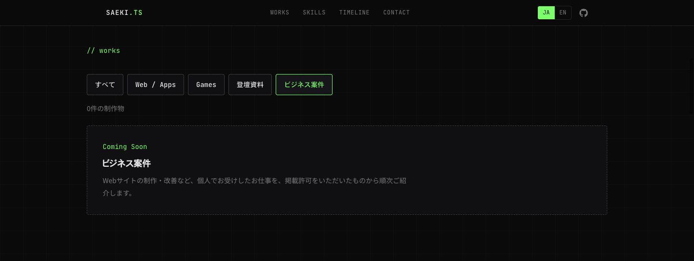

**ビジネス案件、日本語、モバイル幅390、Works部分のキャプチャ**。

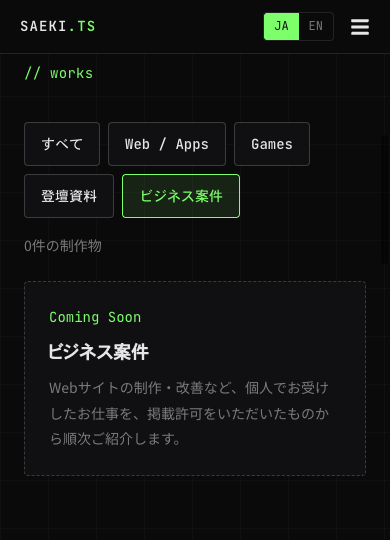

**Client Work、英語、モバイル幅390、Works部分のキャプチャ**。

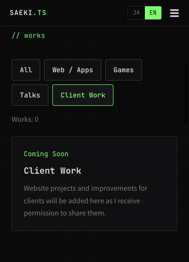

**Web / Apps、英語、モバイル幅390×1000**。折り返したフィルターとストアリンク。

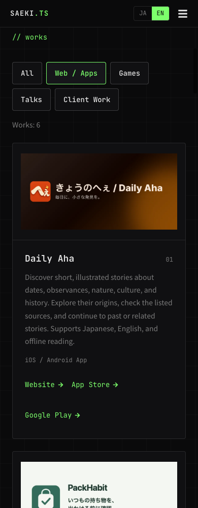

### 残作業

- 本番公開は未実施。公開時には最新mainの依存関係で再検証し、今回の変更を既存の無関係な作業差分から分けて扱う。
- Plane本文・画像は対応プロジェクト確認後に同期する。現段階で添付済みとは扱わない。
- iOS Safari / Android Chromeの実機ブラウザ確認は未実施。

## 2026-11-05追記: 紹介画像の右にアプリ画面を配置（ローカル・未公開）

ユーザーの追加依頼により、Daily AhaとPackHabitのカード上部を「左に既存の紹介画像、右に実画面1枚」の構成へ変更した。元の紹介画像とアプリ画面は別の画像要素で配置する。画面の文字やUIを書き換える生成・合成は行わず、アプリの既存のストア用実画面画像をリサイズ・WebP変換して掲載する。

- Daily Aha: 「柿の日」のホーム画面。元画像は `daily-aha/tools/store-screenshots/public/screenshots/iphone/{ja,en}/01.png`。
- PackHabit: 持ち物のチェック画面。元画像は `packhabit/docs/store/assets/ios-6.9/02-check.png` と `ios-6.9-en/02-check.png`。
- 公開用画像は `public/images/works/{daily-aha,packhabit}-screen-{ja,en}.webp`。各660×1434。元の実画面の縦横比と内容を保持する。
- `WorkItem.screenshot` に画像パスと代替テキストを持たせ、言語切り替え時に日本語・英語の画面を切り替える。スクリーンショットのない既存カードは従来の紹介画像のみを表示する。
- カード上部は従来の16:9枠を維持。紹介画像を残りの幅、実画面を枠内の高さに合わせて表示し、実画面は幅30%を上限とする。PC・モバイルで常に右側へ置く。

実装: main・323ee73＋既存差分＋前段のアプリ・カテゴリ追加＋今回の右側実画面配置。ローカルの未コミット変更。実装対象はContents.tsx、WorkItemの型、日英JSON、画像4枚。アプリ本体には変更しない。

検証: `npm run lint`、`./node_modules/.bin/tsc --noEmit`、`npm run build`、`git diff --check` が成功。既存のNext.js 16.3.0で静的ビルドし、macOS上のPlaywright Chromium実ブラウザで1440×820の日本語と390×1000の日本語・英語を確認。画面画像4枚の読み込み、紹介画像の右に配置されること、Web / Apps 6件維持、代替テキスト、横はみ出しなしを確認。console error / warning 0。画像は全て開いて表示内容を目視確認した。モバイル幅はエミュレーションで、今回アプリ実機から撮り直したものではない。

配信: 引き続きローカルプレビューのみで、本番未反映。Planeは同じチャットで確認した対応プロジェクトなしの状態を保持し、本文・画像は未同期。投稿予定本文はplane-draft.htmlへ追記。

### 表示確認画像

共通条件: **local / 本人のMac / macOS / Playwright Chromium / 2026-11-05 JST / main・323ee73＋既存差分＋本チャットの追加・改訂**。動きを減らす設定とアニメーション終了状態で撮影。

日本語・PC幅1440×820。両アプリの紹介画像の右に実画面1枚を表示。

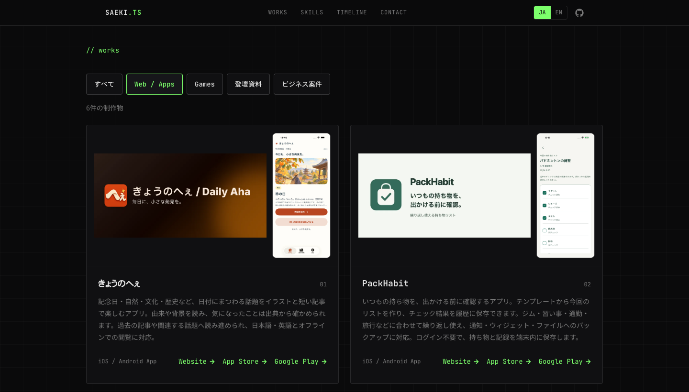

日本語・モバイル幅390×1000。

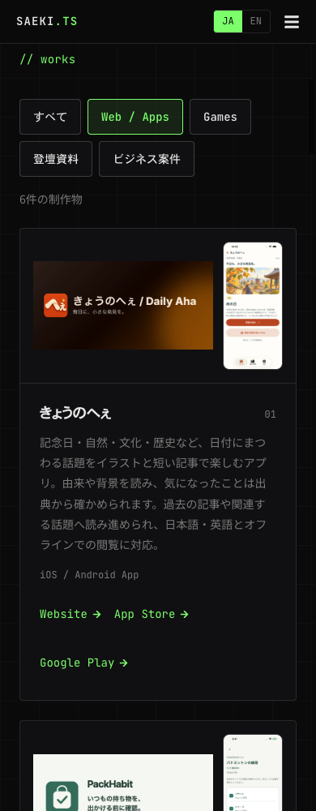

日本語・モバイル幅390のPackHabitカード部分。

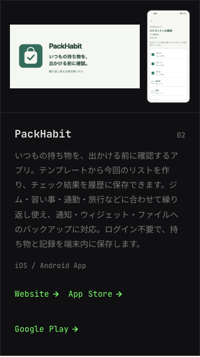

英語・モバイル幅390×1000。英語の実画面へ切り替わる。

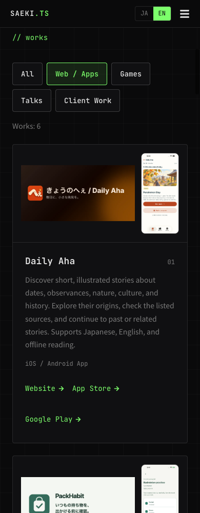

## 2026-11-05の公開準備

ユーザーが今回のアプリ追加・右側実画面・ビジネス案件を確認し、本番反映を承認。最新main・24c48f7からの独立worktreeへ、今回の作業開始前との差分のみを適用した。元チェックアウトのプロフィール、フッター、モーション実験、過去の未コミット配信記録は公開対象に含めない。最新mainのlockfileは変更せず、同じ依存関係で公開用の検証を行う。PR・配信の実行結果は確認後に元の作業記録へ追記する。

### 公開用worktreeでの検証

最新mainのlockfileを使った `npm ci` 後、Next.js 16.4.3でLint・型チェック・静的ビルドが成功。依存関係は変更していない。静的出力にpreview/motionが存在せず、今回の対象ページのみであることを確認した。

2026-11-05 JSTにlocal / 本人のMac / macOS / Playwright Chromiumで、公開対象のブランチ `codex/portfolio-apps-and-client-work`（基準main・24c48f7＋今回の公開用差分）を確認。PC1440×820・日本語とモバイル幅390×1000・英語で、新規カード・各3リンク・言語別実画面の読み込みと右側配置、App件数6、全14件、ビジネス案件0件、Coming Soon、日英切り替え後の選択保持、リンク高さ44px・別タブ属性、横はみ出しなしを確認。console error / warning 0。画像を開いて表示も確認した。

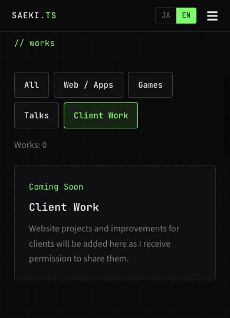
